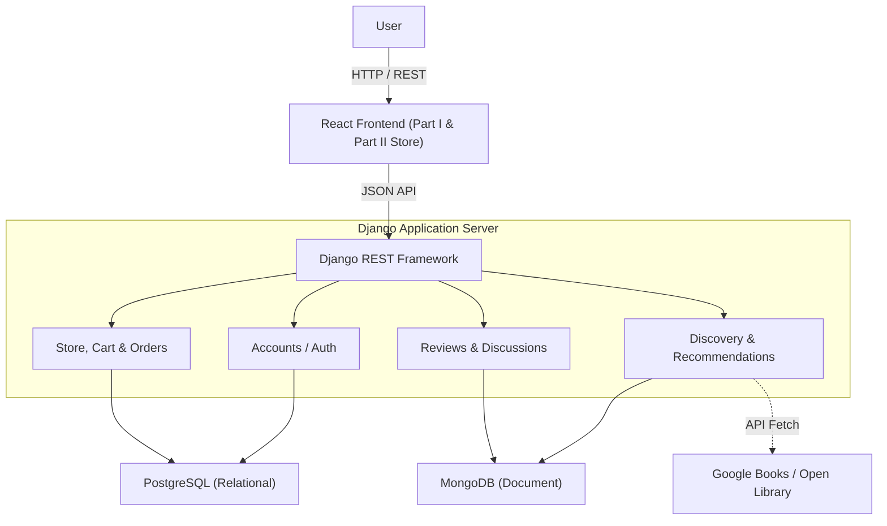
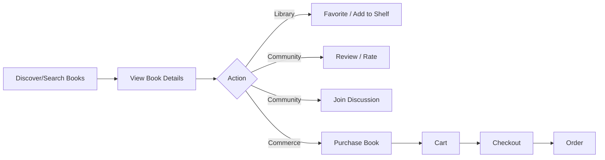
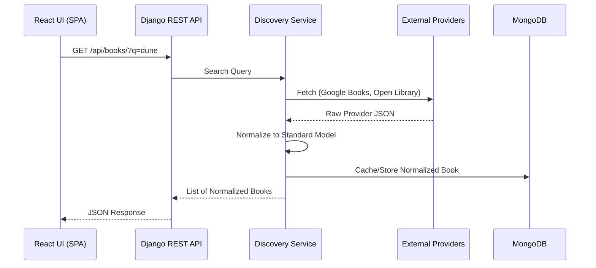
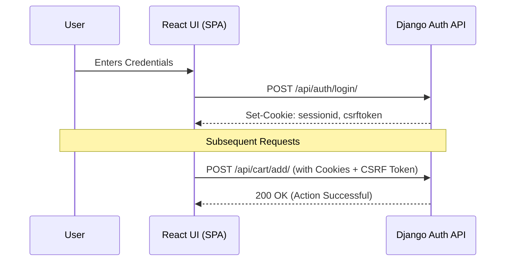
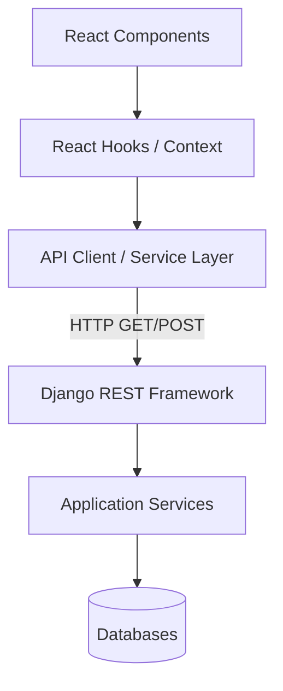

<div align="center">
  <h1>📚 Akashic Library</h1>
  <p><b>Unified Book Discovery, Community & Online Bookstore Platform</b></p>
  <p><i>Discover. Read. Connect. Shop.</i></p>
</div>

<div align="center">
  
  [](#)
  [](#)
  [](#)
  [](#)
  [](#)
  [](#)
  [](#)
  [-brightgreen.svg)](#)

</div>

<br />

## 🚧 Project Status

**Akashic Library Part I (Book Discovery, Reading Sanctuary & Community) is complete, and Part II (Akashic Store — Stages 1A through 6.1) is implemented, tested, and verified.** 
Currently, both **Part I (Discovery & Community)** and **Part II (Akashic Storefront, Multi-Store Cart, Checkout, Admin/Manager Portals & Gifting)** are fully integrated across the Django REST backend and React/TypeScript frontend. **Stage 7 (Discovery Homepage Hero Redesign)** is the upcoming milestone.

| Component | Status | Description |
| :--- | :---: | :--- |
| **Backend & API** | ✅ **Complete** | Django REST Framework API, Database models, Authentication, Multi-Store Commerce & Core Services. |
| **Frontend (Part I)** | ✅ **Complete** | React 19 + TypeScript + Vite SPA: Discovery, Personal Sanctuary, Reading Room, Reviews, Community Hub, Moderator Console. |
| **Commerce Storefront (Part II)** | ✅ **Complete (Stages 1A–6.1)** | Atmospheric 3D hero showcase, All Books catalogue, customizable Book Detail Pages, Admin & Store Manager portals, multi-store Shopping Bag, checkout, simulated QR demo payment, and Gifting page. |
| **Test Coverage** | ✅ **Passing** | **871/871 automated tests passing** (499 backend + 372 frontend unit tests across 52 suites verified). |
| **Integrations** | ✅ **Complete** | External book data providers (Google Books / Open Library) normalized and integrated. |

---

## 📖 What is Akashic Library?

Traditional book platforms often fracture the reading experience. You might discover a book on one site, track your reading progress on another, discuss it on a forum, and purchase it from a separate digital storefront. 

**Akashic Library** aims to bring these disjointed experiences together into a single, cohesive platform. It is designed from the ground up to unify **book discovery, personal library organization, community interaction, and digital commerce.**

### Core Features

#### 📚 Discovery
- Search books via unified external providers (Google Books, Open Library)
- Detailed book metadata and normalization
- Seamless source attribution

#### 👤 Identity
- Secure Registration and Login/Logout
- Session-based authentication (JWT-free by design)
- Role-aware access control

#### ⭐ Personal Library
- Save books to Favorites
- Manage reading progress via custom Shelves

#### 💬 Community
- Rate and review books
- Join and create community discussions
- Platform moderation capabilities

#### 🛒 Store
- Browse physical/digital store products
- Manage shopping cart
- Secure checkout and order processing

#### 🛡️ Administration
- Advanced administrative capabilities
- Role-based moderation and management

*(Note: Both Part I — Discovery, Identity, Personal Library, Reading Room, Community, and Content Moderation — and Part II — Akashic Storefront, All Books catalogue, customizable BDP CMS, role-based Admin & Store Manager portals, multi-store cart/checkout/QR demo payment, and Gifting UI through Stage 6.1 — are implemented in full-stack React + Django.)*

---

## 🏗️ Architecture Diagram

The system employs a **polyglot persistence architecture**, separating relational identity and commerce data from document-based discovery and community data.



*Note: React communicates exclusively with the Django REST API. It never connects directly to PostgreSQL or MongoDB.*

---

## 🔄 System Workflow



---

## 🔍 Book Discovery Data Flow

To provide a seamless experience, Akashic Library normalizes data from multiple external providers before serving it to the client.



---

## 🔐 Authentication Flow



---

## 🌐 Frontend ↔ Backend Integration Strategy



*The frontend relies on centralized service/API abstractions rather than directly constructing database requests or API calls within UI components.*

---

## 📁 Project Structure

### Current Backend Structure
```text
Akashic_Library/
├── Akashic_Library/      # Core settings and URL routing
├── accounts/             # Identity, Users, Roles, Auth
├── discovery/            # Book search, normalization, APIs
├── store/                # E-commerce product management
├── cart/                 # Shopping cart sessions
├── orders/               # Checkout and order processing
├── community/            # Discussions and moderation
├── recommendations/      # Personalized book suggestions
├── requirements.txt      # Python dependencies
└── manage.py             # Django CLI
```

### Frontend Structure (Part I & Part II Implemented)
```text
frontend/
├── public/
│   ├── covers/           # Curated store edition cover artwork
│   └── gifting/          # Gifting storefront visual assets
├── src/
│   ├── assets/           # Static design assets, fonts, icons
│   ├── components/       # Design system tokens, layout, discovery, community, UI primitives
│   │   ├── community/    # Content reporting modals, buttons, moderation console
│   │   ├── discovery/    # BookCard, FilterDrawer, search components
│   │   ├── layout/       # ApplicationShell, Navbar, Footer, Drawers, ChunkErrorBoundary
│   │   └── ui/           # Buttons, Badges, Modals, Containers, Inputs
│   ├── context/          # AuthContext, ToastContext
│   ├── hooks/            # Custom responsive, auth, and state hooks
│   ├── pages/            # Route-level views (Lazy loaded with code splitting)
│   │   ├── AccountSettings/
│   │   ├── Auth/
│   │   ├── BookDetail/   # Book details, legal access options, kindred carousel
│   │   ├── BookReviews/  # Reviews, ratings, nested replies
│   │   ├── Community/    # Community hub, thread previews, discussion dialogue
│   │   ├── DiscoveryHome/# Homepage, spotlight, curated recommendations shelf
│   │   ├── Genres/
│   │   ├── Moderation/   # Moderator console & audit queue
│   │   ├── PersonalLibrary/# Personal shelves, favorites, reading progress
│   │   ├── ReadingRoom/  # Contemplative reader & persistent marginalia
│   │   ├── SearchResults/
│   │   └── Store/        # Akashic Store (Hero, All Books, BDP, Cart, Checkout, Payment, Gifting, Admin & Manager Portals)
│   ├── services/         # Centralized API clients (auth, discovery, library, reviews, moderation, store)
│   ├── test/             # Vitest test setup and mock handlers
│   ├── types/            # Domain TypeScript interfaces
│   ├── utils/            # Formatters, navigation, security helpers
│   ├── App.tsx
│   └── main.tsx
├── package.json
├── tsconfig.json
└── vite.config.ts
```

---

## 🔌 API Documentation

The backend currently exposes the following key API foundations. 
*(Full reference available in `docs/API_REFERENCE.md`)*

| Method | Endpoint | Purpose | Auth Required |
| :--- | :--- | :--- | :---: |
| `GET` | `/api/health/` | System health check | ❌ |
| `POST` | `/api/auth/login/` | Establish user session | ❌ |
| `POST` | `/api/auth/logout/` | Destroy user session | ✅ |
| `GET` | `/api/books/` | Search across external providers | ❌ |
| `GET` | `/api/books/<id>/` | Get normalized book details | ❌ |
| `GET` | `/api/store/products/` | List store products | ❌ |
| `GET` | `/api/store/manager/overview/` | Store Manager portal metrics | ✅ |
| `GET` | `/api/store/admin/overview/` | Central Admin operations & oversight | ✅ |
| `GET` | `/api/cart/` | View current shopping cart | ✅ |
| `POST` | `/api/orders/checkout/` | Process cart into an order | ✅ |
| `POST` | `/api/orders/<id>/confirm-payment/` | Confirm simulated QR demo payment | ✅ |
| `GET` | `/api/community/` | List community discussions | ❌ |
| `GET` | `/api/recommendations/`| List personalized book suggestions | ✅ |

---

## ⚙️ Backend Architecture

The backend is built with **Django 6.1.1** and **Django REST Framework (DRF) 3.18.1**. 

Key technical implementations include:
- **Custom User Model**: UUID-based identity with robust session authentication.
- **Polyglot Persistence**: 
  - PostgreSQL for transactional reliability (Accounts, Orders).
  - MongoDB for flexible document storage (Books, Reviews, Discussions).
- **Service Layer Pattern**: Business logic is decoupled from views/serializers.
- **Provider Adapters**: Extensible adapter pattern for integrating external APIs (Google Books, Open Library).
- **Robust Testing**: Comprehensive unit and integration tests using in-memory databases (`sqlite3` and `mongomock`).

---

## 🧪 Testing

The platform maintains strict test coverage, verifying domain logic, API contracts, database interactions, and frontend component states.

**Current Verified Status:**
- **Backend Test Suite:** **499 / 499 tests passing** ✅
- **Frontend Test Suite:** **372 / 372 tests passing** (52 test suites) ✅
- **Total Automated Tests:** **871 / 871 passing** ✅
- `0 issues` reported by Django check.
- `0 errors, 0 warnings` reported by TypeScript compilation (`tsc -b && vite build`).
- `No changes detected` by migrations check.

```bash
# Backend test execution
python manage.py test --settings=Akashic_Library.test_settings

# Frontend test execution
npm --prefix frontend test -- --run
```
*(Backend tests utilize an in-memory SQLite database and `mongomock` for rapid execution without external infrastructure dependencies. Frontend tests run via Vitest in a jsdom environment.)*

---

## 🚀 Getting Started (Development Setup)

### Prerequisites
- **Python** 3.14.x
- **Node.js** 18+ (LTS) & **npm** 9+
- **PostgreSQL** 14+
- **MongoDB** 6.0+
- **Git**

### 1. Clone & Setup Virtual Environment
```bash
git clone git@github.com:ragnarStark79/Akashic-Library.git
cd Akashic-Library/Akashic_Library

python -m venv venv
source venv/bin/activate
pip install -r requirements.txt
```

### 2. Environment Configuration
**Never commit secrets to version control.**
```bash
cp .env.example .env
```
Edit `.env` and configure your local `DJANGO_SECRET_KEY`, database credentials, and optional API keys.

### 3. Database Migration
```bash
python manage.py migrate
```

### 4. Run the Backend Server
```bash
python manage.py runserver
```
The Django REST API will be available at `http://localhost:8000/api/`.

### 5. Frontend Setup & Run (React / Vite)
In a separate terminal:
```bash
cd frontend
npm install
npm run dev
```
The React development server will start at `http://localhost:3000/` (automatically proxying `/api` requests to Django at `http://127.0.0.1:8000/`).

*(Tip: You can also start both Django and Vite concurrently with a single command using `./dev.sh`, `python run.py`, or `npm run dev`.)*

To verify frontend quality gates:
```bash
npm run test       # Run Vitest test suite (372 tests)
npm run build      # TypeScript typecheck and Vite production build
npm run lint       # ESLint static analysis
```

---

## 🛠️ Configuration & Environment

Sensitive configuration is driven entirely by environment variables via `.env`.

**Key Variables:**
- `DJANGO_SECRET_KEY`
- `DJANGO_DEBUG`
- `POSTGRES_DB` / `POSTGRES_USER` / `POSTGRES_PASSWORD`
- `MONGODB_URI` / `MONGODB_NAME`
- `CORS_ALLOWED_ORIGINS`

For the React frontend, configuration is handled via `VITE_API_BASE_URL` (defaults to `/api` proxy in dev).

---

## 🎨 Design System & UI Vision

Part I establishes the complete design system foundation (Warm Stone aesthetic, serif typography, responsive touch carousels, and accessible components):
- **Book-Centric Visual Hierarchy**: Highlighting cover art with 2:3 aspect-ratio containment (`var(--color-surface-inset)`), typography, and readability.
- **Search-First Experience**: Frictionless discovery and exploration with scope selectors and curated query chips.
- **Responsive Layouts**: Seamless single-row scroll-snap carousels across mobile (360px–440px), tablet (768px–1024px), and desktop (1280px–1440px).
- **Accessible Components**: Adhering to ARIA standards, keyboard navigability, and `prefers-reduced-motion` compliance.
- **Graceful States**: Polished loading skeletons, empty states, and chunk error boundaries.

Part II extends this design system into a separate, atmospheric digital bookstore with 3D product showcases and cinematic portal transitions.

---

## 🗺️ Development Roadmap

### ✅ Completed (Part I — Discovery, Reading & Community)
- [x] **Backend Foundation:** Django REST Framework, custom accounts, and session identity
- [x] **Polyglot Data Architecture:** PostgreSQL (Accounts, Orders) + MongoDB (Books, Reviews, Marginalia, Reports)
- [x] **Phase 0:** Frontend foundation & design system tokens
- [x] **Phase 1:** Navigation shell & application layouts
- [x] **Phase 2A & 2B:** Book discovery, multi-provider search & Open Library integration
- [x] **Phase 3 & 3.1:** Book details experience, data integrity & kindred folios
- [x] **Phase 4A & 4B:** Patron authentication, personal library sanctuary & shelves
- [x] **Phase 4B.1:** Authenticated reading shelf actions stabilization
- [x] **Phase 5A & 5B.1:** Book reviews, 5-star ratings & reader replies
- [x] **Phase 5B.1.1:** Review management, inline editing & deletion confirmation
- [x] **Phase 5B.2:** Reading room, focus mode & persistent marginalia annotations
- [x] **Phase 5B.3:** Community hub, discussion forum & navigation
- [x] **Phase 5B.4 & 5B.4.1:** Thread detail views, nested responses & composer stabilization
- [x] **Phase 6A:** Complete product audit & gap assessment
- [x] **Phase 6B & 6B.1:** Patron profile, account settings, role permissions & password policy enforcement
- [x] **Phase 6C & 6C.1:** Content reporting workflows, moderator console & audit logging
- [x] **Phase 6D & 6D.1:** Recommendations integration, legal access options & book detail stability
- [x] **Phase 6D.2:** Homepage recommendation card containment & responsive carousel fix
- [x] **Phase 6E:** Route-level code splitting, MongoDB compound indexing & query optimization
- [x] **Phase 6F:** Comprehensive end-to-end regression testing, cross-system integration & quality sign-off
- [x] **Phase 6G:** Production readiness, deployment health probes & release packaging
- [x] **Automated Test Coverage:** 584 automated tests passing (341 backend + 243 frontend)

### ✅ Completed (Part II — Akashic Store, Stages 1A–6.1)
- [x] **Stage 1A:** Store commerce architecture, portal transition overlay & application shell
- [x] **Stage 1B (1B.1–1B.2):** Storefront 3D Three.js hero showcase, floating header & `Our Top Books` carousel
- [x] **Stage 1C (1C.1–1C.2):** Editorial `How It Works` stacking section & `Choose From` interactive category covers
- [x] **Stage 1D (1D.1–1D.2):** `Why Akashic` section, animation stabilization & Choose From hover restoration
- [x] **Stage 1E:** `Common Questions` FAQ accordion & redesigned Store Footer
- [x] **Stage 2:** `All Books` catalogue, genre carousels, customizable `BookCard` & Store Manager CRUD portal
- [x] **Stage 3:** Customizable Book Detail Pages (BDP), `StoreProductDetail` CMS, proof cards, excerpt & Book notes
- [x] **Stage 4 & 4.6:** Role-based Auth (`USER` / `STORE_MANAGER` / `ADMIN`), strict portal separation, manager approvals & `init_admin`
- [x] **Stage 5:** Multi-store Shopping Bag, offer selection, inventory sync, checkout, simulated QR payment & invoices
- [x] **Stage 6:** BDP title color customization, WCAG AA card contrast improvements, avatar-only triggers & complete `Gifting` page
- [x] **Stage 6.1:** BDP editorial persistence (`sample_excerpt` / `content_warnings`), demo data audit command & UUID routing stabilization

### ⏳ Upcoming
- [ ] **Stage 7:** Discovery Homepage Hero Redesign & post-Part II refinements

---

## 🤝 Collaboration & Contribution Workflow

This repository utilizes branch protection. **Direct pushes to `main` are prohibited.**

### Workflow
1. **Clone** the repository.
2. **Branch** off `main` for your work.
3. **Commit** using the convention below.
4. **Push** your branch to GitHub.
5. **Open a Pull Request** against `main`.
6. **Merge** only after code review and CI checks pass.

```bash
git checkout main
git pull origin main
git checkout -b feature/your-feature-name

# Make your changes...
git add .
git commit -m "feat: add awesome new functionality"
git push -u origin feature/your-feature-name
```

### Branch Naming Convention
- `feature/<feature-name>`
- `fix/<bug-name>`
- `refactor/<area>`
- `docs/<documentation-change>`
- `test/<testing-change>`
- `chore/<maintenance-task>`

### Commit Convention
- `feat:` for new features.
- `fix:` for bug fixes.
- `docs:` for documentation updates.
- `refactor:` for code refactoring without behavior changes.
- `test:` for adding or updating tests.
- `chore:` for maintenance, dependencies, or tooling.

---

## 🔒 Security Notes

- **Never** commit `.env` files or expose credentials.
- **Backend Responsibility**: Authentication, authorization, and sensitive business logic strictly remain on the Django backend.
- Do not place backend secrets in React environment variables (`VITE_`).
- All external API communication happens Server-to-Server to protect API keys.

---

## 🎓 Academic / Project Context

This platform is developed as a comprehensive academic final-year/semester project demonstrating full-stack engineering, polyglot persistence, software architecture patterns, and API design.

---
<div align="center">
  <p><i>Akashic Library — Expanding the digital reading experience.</i></p>
</div>
