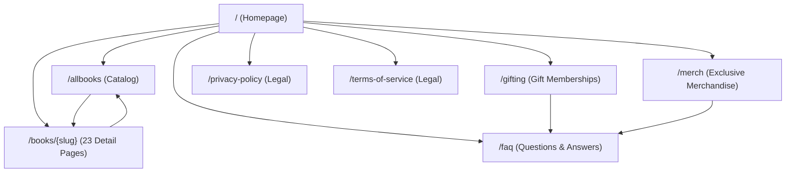
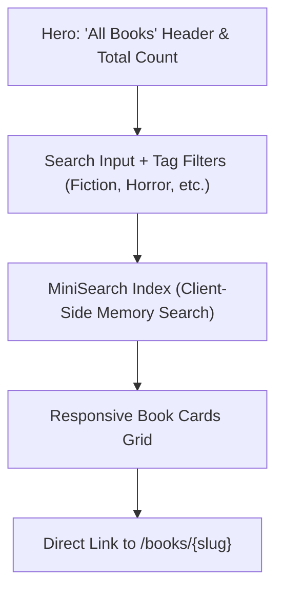
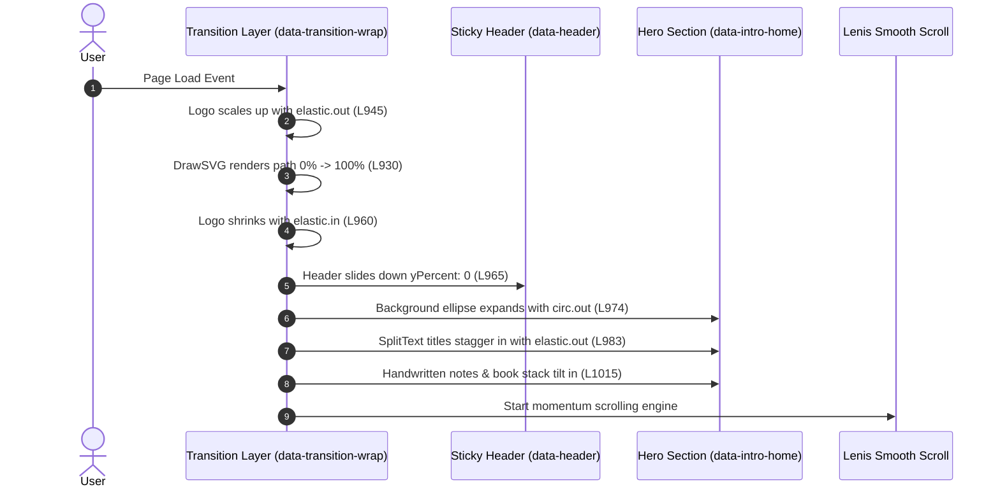

# AKASHIC LIBRARY — PART II
# STAGE 0A: STORE WEBSITE CLONE RECONNAISSANCE & TECHNICAL DOCUMENTATION

> **Document Type:** Senior Reverse Engineering, Web Animation, React Architecture & Technical Analysis Report  
> **Repository:** `Akashic_Library`  
> **Branch:** `ragnar/frontend`  
> **Reference Directory:** `frontend/site-clone/` (`frontend/site-clone/site_copy/`)  
> **Date:** November 17, 2026  
> **Status:** Completed — Ready for Review & Approval  

---

## 1. Executive Summary

This technical documentation report provides an exhaustive, evidence-backed reverse engineering analysis of the locally downloaded Aardvark Book Club educational reference clone located at `frontend/site-clone/site_copy/` within the Akashic Library repository. The goal of this analysis is to deconstruct the visual hierarchy, kinetic animations, component systems, asset pipelines, responsive adaptations, and client-side logic of the reference site, establishing a blueprint to reconstruct the **Akashic Store (Part II)** within our existing React 19 + TypeScript + Vite frontend.

### Key Reverse Engineering Findings

1. **Website Composition & Inventory:**
   - **30 HTML Pages:** Exactly 1 Homepage (`index.html`), 1 All Books catalog (`allbooks/index.html`), 23 Individual Book Detail pages (`books/<slug>/index.html`), 1 Gifting page (`gifting/index.html`), 1 Merch page (`merch/index.html`), 1 FAQ page (`faq/index.html`), 1 Privacy Policy page (`privacy-policy/index.html`), and 1 Terms of Service page (`terms-of-service/index.html`).
   - **213 Local Files Total (28.05 MB):** 137 WebP images (10.87 MB), 30 HTML documents (3.98 MB), 16 JavaScript scripts (0.49 MB), 12 high-resolution transparent PNG cutouts (12.29 MB), 10 vector SVG badges and logos (0.06 MB), 4 WOFF2 web fonts (0.17 MB), 3 CSS stylesheets (0.17 MB), and 1 WOFF font (0.04 MB).
2. **Animation Engine & Custom Libraries:**
   - The reference website is powered by **GSAP 3.15.0** (with registered plugins: `ScrollTrigger`, `SplitText`, `CustomEase`, `InertiaPlugin`, `DrawSVGPlugin`), **Barba.js 2.10.3** for PJAX seamless page transitions, **Lenis 1.3.17** for smooth momentum scrolling, **Smooothy 0.0.35** for physics-based touch/drag carousels, and **MiniSearch 7.1.2** for client-side search indexing on `/allbooks`.
   - Custom easing curves defined include `"osmo"` (`0.625, 0.05, 0, 1`), `"path-ease"` (`0.78, 0.18, 0.18, 1`), and `"energy"` (`M0,0 C0.32,0.72 0,1 1,1`).
   - Custom carousel wrappers extend `Smooothy`: `ParallaxSlider` (with randomized tilt angles), `CenterSlider`, `Slider`, and `FilterSlider`.
3. **The "3D" Myth vs. Reality (Scroll-Driven 2D Canvas Sequences):**
   - The reference site **does not use WebGL, Three.js, or `<model-viewer>`**. What appears to be an interactive 3D box unboxing and a 3D hero book display is actually **scroll-driven 2D HTML5 Canvas image frame sequences** rendered at 24fps via GSAP ScrollTrigger.
4. **Critical Missing Assets Discovered:**
   - **Canvas Image Sequences:** Both `data-hero-sequence-canvas` (120 frames: `frame_000.webp` to `frame_119.webp`) and `data-box-sequence-canvas` (120 frames: `box/frame-000.webp` to `frame-119.webp`) were hosted on an external BunnyCDN edge (`https://aardvark-book-club.b-cdn.net/`) that was **never downloaded by the crawler**.
   - **Remote Webflow CDN Images:** 284 remote `https://cdn.prod.website-files.com/...` image tags remain un-crawled across the HTML files (including 52 missing images on the homepage alone) because the Playwright crawler only captured assets that triggered within its initial 5-scroll pass.
5. **Architectural Integration Strategy:**
   - Part I (Akashic Library Book Discovery, Reading Room, Reviews, Personal Library, Community) remains 100% untouched.
   - Akashic Store will reside in `frontend/src/pages/Store/` using view-state routing (`view: 'store' | 'store-allbooks' | ...`) within `App.tsx`.
   - CSS isolation will be guaranteed via CSS Modules (`*.module.css`) to prevent Webflow utility class conflicts with Akashic Library's vanilla and Tailwind styles.
   - User identity and authentication will seamlessly connect to Akashic Library's existing session auth (`useAuth()` via `/api/auth/me/`).

---

## 2. Source Directory Inventory

The downloaded reference files are housed in `frontend/site-clone/`:
- `README.md` (Crawler documentation and setup instructions)
- `crawl.py` (Playwright crawling script)
- `requirements.txt` (Python crawler requirements)
- `site_copy/` (The locally preserved website mirror)

### File Count and Storage Footprint

| Category | Extensions | File Count | Disk Size (KB) | Disk Size (MB) | Primary Role |
| :--- | :--- | :---: | :---: | :---: | :--- |
| **Images (Raster)** | `.webp` | 137 | 11,126.9 KB | 10.87 MB | Book covers, author photos, lifestyle photography, background visuals |
| **Transparent Cutouts** | `.png` | 12 | 12,581.0 KB | 12.29 MB | High-res cutout book covers, boxed sets, special edition foil covers |
| **Vector Graphics** | `.svg` | 10 | 57.7 KB | 0.06 MB | Logos, star badges, circular stamps, decorative marks |
| **Web Pages** | `.html` | 30 | 4,077.1 KB | 3.98 MB | Static HTML page captures with Webflow markup |
| **JavaScript Scripts** | `.js` | 16 | 505.4 KB | 0.49 MB | GSAP, Barba, Lenis, Smooothy, MiniSearch, jQuery, Webflow, Slater |
| **Stylesheets** | `.css` | 3 | 171.5 KB | 0.17 MB | Lenis smooth scroll, Webflow core CSS, Slater custom typography & layout |
| **Web Fonts** | `.woff2`, `.woff` | 5 | 208.6 KB | 0.20 MB | Degular (Medium, Semibold, Bold), Champ (ExtraBold), Hello Organichand |
| **TOTAL** | — | **213** | **28,728.2 KB** | **28.05 MB** | Complete local reference mirror |

### Directory Hierarchy Breakdown

```
frontend/site-clone/site_copy/
├── index.html                                 [Homepage - 11 sections + header + footer + transition]
├── allbooks/index.html                        [Catalog with MiniSearch & filter tags]
├── books/                                     [23 Individual Book Detail Pages]
│   ├── a-drop-of-corruption-reprint/index.html
│   ├── a-trade-of-blood/index.html
│   ├── blacktail/index.html
│   ├── bodies-of-magic/index.html
│   ├── bones-of-jade-flesh-like-ice/index.html
│   ├── carrying/index.html
│   ├── chain-gang-all-stars-2023-members-choice-winner/index.html
│   ├── crone/index.html
│   ├── fruit-fly/index.html
│   ├── lethal-kiss/index.html
│   ├── love-you-to-death/index.html
│   ├── mazywood/index.html
│   ├── milkteeth/index.html
│   ├── monsters-of-ohio/index.html
│   ├── scion/index.html
│   ├── solace-house/index.html
│   ├── stations/index.html
│   ├── the-buffalo-hunter-hunter-2025-members-choice-winner/index.html
│   ├── the-reformatory-2024-members-choice-winner/index.html
│   ├── the-secret-dinner/index.html
│   ├── there-used-to-be-people-here/index.html
│   ├── venus-vanishing/index.html
│   └── what-feeds-below/index.html
├── faq/index.html                             [Accordion FAQ page]
├── gifting/index.html                         [Gift box pricing tiers & checkout entry]
├── merch/index.html                           [Aardvark apparel & reading accessory products]
├── privacy-policy/index.html                  [Legal Privacy Policy]
├── terms-of-service/index.html                [Legal Terms of Service]
└── _ext/                                      [Externally fetched assets mirror]
    ├── cdn.jsdelivr.net/npm/                  [Vendored modern JS & CSS libraries]
    ├── cdn.prod.website-files.com/            [Webflow static assets, responsive images, web fonts]
    ├── d3e54v103j8qbb.cloudfront.net/         [jQuery 3.5.1]
    └── slater.app/18601/                      [Slater custom CSS (54934.css) & JS (54937.js)]
```

---

## 3. Complete Website Sitemap

The crawler captured 30 HTML files representing 8 distinct route archetypes:



### Route & Sitemap Inventory Table

| # | Route / Local File | Page Title / Identity | Barba Namespace | Canonical URL | Sections Present |
| :---: | :--- | :--- | :--- | :--- | :---: |
| **1** | `index.html` | Aardvark Book Club — A book club for the modern reader | `home` | `https://www.aardvarkbookclub.com/` | 11 |
| **2** | `allbooks/index.html` | All Books — Browse our library | `allbooks` | `https://www.aardvarkbookclub.com/allbooks` | 7 |
| **3** | `books/a-drop-of-corruption-reprint/index.html` | A Drop of Corruption (Reprint) | `book` | `https://www.aardvarkbookclub.com/books/...` | 5 |
| **4** | `books/a-trade-of-blood/index.html` | A Trade of Blood | `book` | `https://www.aardvarkbookclub.com/books/...` | 6 |
| **5** | `books/blacktail/index.html` | Blacktail | `book` | `https://www.aardvarkbookclub.com/books/...` | 6 |
| **6** | `books/bodies-of-magic/index.html` | Bodies of Magic | `book` | `https://www.aardvarkbookclub.com/books/...` | 6 |
| **7** | `books/bones-of-jade-flesh-like-ice/index.html` | Bones of Jade, Flesh Like Ice | `book` | `https://www.aardvarkbookclub.com/books/...` | 6 |
| **8** | `books/carrying/index.html` | Carrying | `book` | `https://www.aardvarkbookclub.com/books/...` | 6 |
| **9** | `books/chain-gang-all-stars-2023-members-choice-winner/index.html` | Chain-Gang All-Stars (2023 Winner) | `book` | `https://www.aardvarkbookclub.com/books/...` | 6 |
| **10** | `books/crone/index.html` | Crone | `book` | `https://www.aardvarkbookclub.com/books/...` | 6 |
| **11** | `books/fruit-fly/index.html` | Fruit Fly | `book` | `https://www.aardvarkbookclub.com/books/...` | 6 |
| **12** | `books/lethal-kiss/index.html` | Lethal Kiss | `book` | `https://www.aardvarkbookclub.com/books/...` | 6 |
| **13** | `books/love-you-to-death/index.html` | Love You to Death | `book` | `https://www.aardvarkbookclub.com/books/...` | 6 |
| **14** | `books/mazywood/index.html` | Mazywood | `book` | `https://www.aardvarkbookclub.com/books/...` | 6 |
| **15** | `books/milkteeth/index.html` | Milkteeth | `book` | `https://www.aardvarkbookclub.com/books/...` | 6 |
| **16** | `books/monsters-of-ohio/index.html` | Monsters of Ohio | `book` | `https://www.aardvarkbookclub.com/books/...` | 6 |
| **17** | `books/scion/index.html` | Scion | `book` | `https://www.aardvarkbookclub.com/books/...` | 6 |
| **18** | `books/solace-house/index.html` | Solace House | `book` | `https://www.aardvarkbookclub.com/books/...` | 6 |
| **19** | `books/stations/index.html` | Stations | `book` | `https://www.aardvarkbookclub.com/books/...` | 6 |
| **20** | `books/the-buffalo-hunter-hunter-2025-members-choice-winner/index.html` | The Buffalo Hunter Hunter | `book` | `https://www.aardvarkbookclub.com/books/...` | 6 |
| **21** | `books/the-reformatory-2024-members-choice-winner/index.html` | The Reformatory | `book` | `https://www.aardvarkbookclub.com/books/...` | 6 |
| **22** | `books/the-secret-dinner/index.html` | The Secret Dinner | `book` | `https://www.aardvarkbookclub.com/books/...` | 6 |
| **23** | `books/there-used-to-be-people-here/index.html` | There Used to Be People Here | `book` | `https://www.aardvarkbookclub.com/books/...` | 6 |
| **24** | `books/venus-vanishing/index.html` | Venus Vanishing | `book` | `https://www.aardvarkbookclub.com/books/...` | 6 |
| **25** | `books/what-feeds-below/index.html` | What Feeds Below | `book` | `https://www.aardvarkbookclub.com/books/...` | 6 |
| **26** | `faq/index.html` | Frequently Asked Questions | `faq` | `https://www.aardvarkbookclub.com/faq` | 4 |
| **27** | `gifting/index.html` | Gift a Membership | `gift` | `https://www.aardvarkbookclub.com/gifting` | 5 |
| **28** | `merch/index.html` | Merch — Shop Aardvark Goods | `merch` | `https://www.aardvarkbookclub.com/merch` | 5 |
| **29** | `privacy-policy/index.html` | Privacy Policy | `terms` | `https://www.aardvarkbookclub.com/privacy-policy` | 2 |
| **30** | `terms-of-service/index.html` | Terms of Service | `terms` | `https://www.aardvarkbookclub.com/terms-of-service` | 2 |

---

## 4. Homepage Section-by-Section Analysis

The homepage (`index.html`) is wrapped in `<div data-barba="wrapper">` and comprises an initial transition loader, a sticky animated header, 11 `<main>` sections, a mobile drawer menu, and an animated parallax footer.

```
┌─────────────────────────────────────────────────────────────┐
│ 0. Transition Overlay (Fullscreen SVG Path Draw & Logo)      │
├─────────────────────────────────────────────────────────────┤
│ Header: Logo | Books, Gifting, Merch, FAQ | Login | CTA     │
├─────────────────────────────────────────────────────────────┤
│ 1. Hero: Kinetic Typography, Book Visual Stack, CTA         │
├─────────────────────────────────────────────────────────────┤
│ 2. Books Slider: ParallaxSlider with Randomized Tilt Angles │
├─────────────────────────────────────────────────────────────┤
│ 3. Flow (How It Works): 3 Scalloped Step Cards              │
├─────────────────────────────────────────────────────────────┤
│ 4. Box Unboxing Sequence: Canvas Scroll Scrub               │
├─────────────────────────────────────────────────────────────┤
│ 5. Genre Carousel: Horizontal Category Drag & Filtering     │
├─────────────────────────────────────────────────────────────┤
│ 6. Benefits Marquee: Rotating Circular SVG Badges           │
├─────────────────────────────────────────────────────────────┤
│ 7. FAQ Preview: Accordion Expansion Items                   │
├─────────────────────────────────────────────────────────────┤
│ 8. Gifting Banner: Promotional Card with CTA                │
├─────────────────────────────────────────────────────────────┤
│ 9. Rotating Stamp Badge Visual                              │
├─────────────────────────────────────────────────────────────┤
│ 10. Members' Choice Winners: ParallaxSlider + Emoji Rain    │
├─────────────────────────────────────────────────────────────┤
│ 11. Exclusive Merchandise / Community Teaser                │
├─────────────────────────────────────────────────────────────┤
│ Footer: Curved Clip-Path, Socials, Mailchimp Form, Credits   │
└─────────────────────────────────────────────────────────────┘
```

### Detailed Breakdown of Every Section

#### 0. Initial Loader & Transition Layer
- **Markup:** `<div class="transition" data-transition-wrap>` (`index.html#L38-L51`)
- **Visuals:** Fullscreen fixed overlay featuring an SVG path (`<path d="...">`) and an elastic logo badge `<div data-transition-logo>`.
- **Choreography:**
  - `transitionLogo` scales up from 0 to 1 with an overshoot elastic ease `elastic.out(1, 0.72)`.
  - GSAP `DrawSVGPlugin` renders the transition path from `0%` to `100%` with `circ.out` keyframes.
  - `transitionLogo` scales back down to 0 with `elastic.in(1, 0.72)`.
  - At `start+=1.1s`, the header slides down from `yPercent: -100` to `0` using custom ease `"energy"`.
  - Homepage background expands via an ellipse clip-path (`ellipse(150% 130% at 100% 100%)`).

#### 1. Hero Section (`<section class="hero is--bg-yellow" data-intro-home>`)
- **Purpose:** Primary brand statement, visual hook, and conversion CTA.
- **Background:** Warm yellow (`#ffe169`), clipped on desktop via dynamic SVG/CSS ellipse curves.
- **Visuals:**
  - Layered book stack: `package-visual-p-800.webp` and cutout book covers.
  - Floating decorative stickers and easter egg button: `<div data-hero-easter-egg>`.
  - Handwritten annotation text using `Hello Organichand Webfont`.
- **Animation:** SplitText splits the heading into words and characters, animating them with an elastic pop-in (`rotate: 8deg`, `scaleY: 0.1` to `1`, `stagger: 0.088s`).
- **Canvas Sequence:** Contains `<canvas data-hero-sequence-canvas data-desktop-src="https://aardvark-book-club.b-cdn.net/frame_" data-frames="120">`.

#### 2. Books Slider Section (`<section class="books is--bg-white">`)
- **Purpose:** Highlights current monthly book selections with interactive browsing.
- **Layout:** Horizontal drag-and-scroll carousel initialized via `ParallaxSlider`.
- **Card Structure:** Each book card has a cover image, title, author, genre pill tags, page count, and a link to `/books/<slug>`.
- **Visual Effect:** Subtle randomized card tilt (`rotate: -3deg` to `+3deg`) with depth parallax on horizontal drag.

#### 3. How It Works Section (`<section class="flow is--inner-clip is--bg-soft-pink">`)
- **Purpose:** Clarifies the 3-step membership model (1. Pick your book, 2. Build your box, 3. Delivered to your door).
- **Background:** Soft blush pink with scalloped decorative boundary clips (`is--inner-clip`).
- **Cards:** 3 large step cards with numbered badge pills, playful illustrative icons, and concise copy.

#### 4. Box Unboxing Sequence (`<section class="box" data-box-sequence>`)
- **Purpose:** High-impact scroll-driven unboxing showcase showing the physical package opening.
- **Mechanism:** `<canvas data-box-sequence-canvas data-desktop-src="https://aardvark-book-club.b-cdn.net/box/frame-" data-frames="120">`.
- **Scrubbing:** ScrollTrigger pins the section and scrubs frame indexes from `000` to `119` based on scroll progress.
- **Copy Overlay:** Pinned headlines that transition from "A delivery day dream" to "Curated perfection."

#### 5. Genre Carousel Section (`<section class="genre is--bright-pink">`)
- **Purpose:** Lets readers explore offerings across literary genres (Horror, Sci-Fi, Romance, Literary Fiction, Thriller, Fantasy).
- **Background:** Vibrant bright pink (`#ff6392`).
- **Interaction:** Uses `FilterSlider` allowing horizontal category scrolling, chip clicks, and dynamic active-state transitions.

#### 6. Benefits Marquee Section (`<section class="benefits">`)
- **Purpose:** Social proof and product quality highlights (Hardcover quality, foil embossing, exclusive bookmark included).
- **Visuals:** Continuous rotating circular badge (`benefits-text-eng.svg`) combined with an infinite marquee ticker.

#### 7. FAQ Preview Section (`<section class="faq is--bg-white">`)
- **Purpose:** Addresses common purchasing questions without requiring page navigation.
- **Components:** Collapsible accordion rows with animated plus/minus icons, toggled via GSAP height transitions.
- **CTA:** "Have more questions? Read our full FAQ" linking to `/faq`.

#### 8. Gifting Section (`<section class="gift">`)
- **Purpose:** Promotes gift memberships for birthdays and holidays.
- **Visuals:** Graphic illustration of a gift-wrapped book with "Shop gifts!" CTA button linking to `/gifting`.

#### 9. Badge Section (`<section class="badge">`)
- **Purpose:** Transitional visual separator featuring a rotating circular stamp badge that rotates continuously with page scroll.

#### 10. Members' Choice Winners Section (`<section class="choice is--outer-clip is--bg-yellow">`)
- **Purpose:** Celebrates annual reader-voted books of the year.
- **Animation:** `initEmojiRain()` triggers falling floating confetti/emoji particles when scrolled into view.
- **Slider:** Houses a specialized `CenterSlider` displaying previous years' winners (`the-buffalo-hunter-hunter`, `the-reformatory`, `chain-gang-all-stars`).

#### 11. Exclusive Merchandise Section (`<section class="exclusive is--bg-white">`)
- **Purpose:** Showcases hats, totes, reading socks, and club apparel.
- **Cards:** Product grid with image zoom hover states and pricing, linking to `/merch`.

#### 12. Footer (`<footer class="footer" data-footer>`)
- **Purpose:** Global site navigation, newsletter capture, social links, and legal fine print.
- **Visual Styling:** Distinct curved top border (`clip-path: ellipse(...)`), dark forest green background.
- **Features:** Mailchimp newsletter input form, country currency selector, designer credits, and a "Back to top" smooth-scroll button.

---

## 5. All Books Page Analysis

The `/allbooks` page (`allbooks/index.html`) is the catalog hub designed for real-time client-side exploration of the full 23+ book collection.



### Structural Breakdown
- **Hero Banner (`hero-xs`):** Displays catalog title, count badge, and search filter input (`<input data-search-input placeholder="Search books, authors...">`).
- **Tag Filtering Bar:** Horizontal scrollable category chips (`All`, `Fiction`, `Horror`, `Sci-Fi`, `Thriller`, `Romance`, `Debut`).
- **MiniSearch Client-Side Architecture (`54937.js#L2465`):**
  - Instant index built from DOM data attributes (`data-search-target-book-title`, `data-search-target-book-author`, `data-search-target-book-tags`).
  - Search configuration: Prefix search enabled, fuzzy tolerance `0.2`, combine mode `"AND"`.
  - Zero-latency client filtering without backend round-trips.
- **Product Card Layout:** 3-column desktop / 2-column tablet / 1-column mobile CSS Grid.
  - Card components: High-res WebP jacket cover, badge pill ("Aardvark Exclusive"), title, author, release month, and hover state tilt.

---

## 6. Individual Book Page Template Analysis

All 23 book pages inside `books/<slug>/index.html` derive from a single unified Webflow CMS Collection template.

### Comparative Template Section Audit

| Section Class | Description & Contents | Present in 22 Books | Present in `a-drop-of-corruption-reprint` |
| :--- | :--- | :---: | :---: |
| `hero-xs` | Book title, author, genre pill tags, release date, purchase CTA button | Yes | Yes |
| `detail` | 2-column layout: High-res transparent book cover cutout + metadata list | Yes | Yes |
| `content` | Editorial synopsis, quote highlights, author bio, page count, ISBN | Yes | Yes |
| `flow` | Scalloped "How It Works" 3-step membership reassurance banner | Yes | Yes |
| `notes` | **"Why We Selected It" — Editorial review & curator tasting notes** | **Yes** | **NO (Omitted)** |
| `related` | Horizontal `ParallaxSlider` of "More books you might love" | Yes | Yes |

> **Audit Insight:** Exactly 22 out of 23 pages include all 6 sections. `a-drop-of-corruption-reprint` omits `<section class="notes">` because it is a special reprint title without standard monthly curator notes. The React implementation must treat `curatorNotes` as an optional prop (`curatorNotes?: CuratorNoteData`).

---

## 7. Gifting, Merchandise, and FAQ Analysis

### 1. Gifting Page (`gifting/index.html`)
- **Sections:** `hero-xs`, `subscription`, `features`, `box`, `faq` (5 sections).
- **Core Feature:** Pricing tier selector cards (1-Month Box, 3-Month Box, 6-Month Box, 12-Month Box).
- **Payment Linkage:** Each tier CTA button (`data-gift-tier-btn`) is a direct external link to a **Stripe Checkout** hosted session (`buy.stripe.com/12345...`).
- **Features Breakdown:** Detailed graphic callouts showing gift box packaging, custom gift redemption message card, and voucher code redemption steps.

### 2. Merch Page (`merch/index.html`)
- **Sections:** `hero-xs`, `subscription` (merch product grid), `features`, `box`, `faq` (5 sections).
- **Architecture:** Reuses the exact layout structure of the gifting template, replacing membership cards with physical product cards (Enamel Pins, Canvas Tote Bags, Reading Socks, Embroidered Dad Hats).
- **Checkout:** CTAs direct to Stripe Checkout links.

### 3. FAQ Page (`faq/index.html`)
- **Sections:** `hero-xs`, `faq`, `badge`, `box` (4 sections).
- **Categories:** Grouped into 4 major tabs: *General*, *Membership & Billing*, *Shipping & Delivery*, *Books & App*.
- **Interaction:** Single-expand accordion with smooth GSAP height auto-calculation and focusable keyboard controls.

---

## 8. Navigation and Footer Analysis

### Header Navigation (`<header class="header" data-header>`)
- **Fixed / Sticky Reveal:** Header starts hidden above the viewport (`yPercent: -100`) and animates down after the initial loader completes (`54937.js#L965`).
- **Navigation Links:**
  1. `All Books` -> `/allbooks`
  2. `Gifting` -> `/gifting`
  3. `Merch` -> `/merch`
  4. `FAQ` -> `/faq`
- **Right Action Cluster:**
  - Login button -> External webview (`https://app.aardvarkbookclub.com/login`)
  - "Join the Club" primary CTA -> Mobile app onboarding / Stripe
  - Country Switcher -> UK site toggle (`https://www.aardvarkbookclub.co.uk`)
  - Mobile Hamburger Menu Button (`data-menu-toggle`)

### Mobile Drawer Menu (`<div class="menu" data-menu-wrap>`)
- **Behavior:** Fullscreen slide-over sheet triggered by hamburger toggle.
- **Animation:** Background expands with staggered text links appearing from bottom to top with rotation.
- **Includes:** Duplicate navigation links, member login CTA, app store badges, and social media handles.

### Parallax Footer (`<footer class="footer" data-footer>`)
- **Visuals:** Scalloped top edge, dark forest green background.
- **Scroll Effect:** Positioned beneath the main content with a subtle parallax reveal effect on scroll-out.
- **Links & Credits:**
  - Full internal link matrix (Books, Gifting, Merch, FAQ, Privacy, Terms).
  - Newsletter Signup: Form action pointing to Mailchimp (`aardvarkbookclub.us9.list-manage.com`).
  - Studio Credits: Dylan Brouwer Design (`www.dylanbrouwer.design`) & Future Three Studio (`www.futurethree.studio`).

---

## 9. Interaction and Link Map

| Interaction Element | Section / Location | Current Target in Clone | Local vs Remote | Proposed Akashic Store Action |
| :--- | :--- | :--- | :---: | :--- |
| **Store Logo** | Header & Footer | `/` (`index.html`) | Local | Navigates to Store Home (`view: 'store'`) |
| **All Books** | Header / Menu | `/allbooks` | Local | Navigates to Store Catalog (`view: 'store-allbooks'`) |
| **Gifting** | Header / Menu | `/gifting` | Local | Navigates to Store Gifting (`view: 'store-gifting'`) |
| **Merch** | Header / Menu | `/merch` | Local | Navigates to Store Merch (`view: 'store-merch'`) |
| **FAQ** | Header / Menu | `/faq` | Local | Navigates to Store FAQ (`view: 'store-faq'`) |
| **Member Login** | Header / Menu | `app.aardvarkbookclub.com` | **Remote** | **Replaced by Akashic Auth (`view: 'auth'`)** |
| **Join Now / Box CTA** | Hero / Banners | `buy.stripe.com/...` | **Remote** | **Connects to Akashic Store Cart / Checkout** |
| **Book Card** | Sliders / Grid | `/books/<slug>` | Local | Navigates to Book Detail (`view: 'store-book-detail'`) |
| **Genre Chips** | Homepage Genre | Smooth horizontal scroll | Local | Filters book collection dynamically |
| **FAQ Accordion** | FAQ Sections | Expand/collapse inline | Local | Pure React state-managed accordion |
| **Return to Discovery** | Header Switcher | N/A (New requirement) | — | **One-click portal return to Akashic Discovery** |

---

## 10. Loading Screen and Animation Architecture

The website's animation architecture is organized within `site_copy/_ext/slater.app/18601/54937.js` (5,540 lines of code).



### Detailed Animation Specifications
1. **Registered Plugins (`54937.js#L4`):**
   ```javascript
   gsap.registerPlugin(ScrollTrigger, SplitText, CustomEase, InertiaPlugin, DrawSVGPlugin);
   ```
2. **Custom Easing Profiles (`54937.js#L28-L30`):**
   - `"osmo"`: `CustomEase.create("osmo", "0.625, 0.05, 0, 1")` (Used for page transitions)
   - `"path-ease"`: `CustomEase.create("path-ease", "0.78, 0.18, 0.18, 1")` (Used for SVG stroke morphing)
   - `"energy"`: `CustomEase.create("energy", "M0,0 C0.32,0.72 0,1 1,1")` (Used for snappy UI drops and buttons)
3. **Barba.js Lifecycle Hooks (`54937.js#L2183-L2230`):**
   - `initOnceFunctions()`: Registers resize observers, media query listeners, and Lenis.
   - `initBeforeEnterFunctions(next)`: Prepares DOM containers, resets scroll positions to top.
   - `runPageLeaveAnimation(current, next)`: Draws SVG curtain over current page.
   - `runPageEnterAnimation(next)`: Uncurtains new page, animates page-specific hero elements.
   - `initAfterEnterFunctions(next)`: Initializes carousels (`Smooothy`), canvas scrubbing, and accordions.
4. **Interactive Carousels (`Smooothy` Subclasses):**
   - `ParallaxSlider`: Adds randomized degree rotation (`rotate: -2deg` to `+2deg`) based on drag velocity.
   - `CenterSlider`: Snaps the active card to exact viewport center.
   - `FilterSlider`: Manages multi-category filtering with slide-to-target alignment.

---

## 11. JavaScript Dependency Inventory

| Library | Version | File Path | Exact Purpose in Clone | React Replacement Plan |
| :--- | :---: | :--- | :--- | :--- |
| **GSAP** | 3.15.0 | `_ext/cdn.jsdelivr.net/.../gsap.min.js` | Core animation engine | Install official `gsap` npm package |
| **ScrollTrigger** | 3.15.0 | `_ext/cdn.jsdelivr.net/.../ScrollTrigger.min.js` | Scroll-driven scrubbing & pinning | Import from `gsap/ScrollTrigger` |
| **CustomEase** | 3.15.0 | `_ext/cdn.jsdelivr.net/.../CustomEase.min.js` | Proprietary easing curves | Import from `gsap/CustomEase` |
| **InertiaPlugin** | 3.15.0 | `_ext/cdn.jsdelivr.net/.../InertiaPlugin.min.js` | Momentum drag physics | Replaced with CSS / Framer Motion or GSAP |
| **SplitText** | 3.15.0 | `_ext/cdn.jsdelivr.net/.../SplitText.min.js` | Text character/word splitting | Native React character wrapping helper |
| **DrawSVGPlugin** | 3.15.0 | `_ext/cdn.jsdelivr.net/.../DrawSVGPlugin.min.js` | SVG stroke drawing | CSS `stroke-dasharray` / GSAP |
| **Barba.js** | 2.10.3 | `_ext/cdn.jsdelivr.net/.../barba.umd.min.js` | Single-page AJAX page transitions | Replaced by React component unmount/mount transitions |
| **Lenis** | 1.3.17 | `_ext/cdn.jsdelivr.net/.../lenis.min.js` | Smooth momentum scrolling | Install `lenis` npm package |
| **Smooothy** | 0.0.35 | `_ext/cdn.jsdelivr.net/.../smooothy.min.js` | Custom drag carousel base | Native React touch/mouse drag carousel |
| **MiniSearch** | 7.1.2 | `_ext/cdn.jsdelivr.net/.../index.min.js` | Client-side fuzzy search on `/allbooks` | Native TypeScript fuzzy filter or `minisearch` |
| **jQuery** | 3.5.1 | `_ext/d3e54v103j8qbb.cloudfront.net/...` | Legacy Webflow dependency | **ELIMINATED** (Zero jQuery in React) |
| **Webflow Runtime** | Multi | `_ext/cdn.prod.website-files.com/...` | Webflow interactions & forms | **ELIMINATED** (Replaced by React handlers) |
| **Slater App Script**| Custom | `_ext/slater.app/18601/54937.js` | Custom site animations & logic | Refactored into clean React custom hooks |

---

## 12. Asset and Media Inventory

### Asset Types and Distribution

```
Total Preserved Assets: 28.05 MB (213 files)
├── Images (WebP): 137 files (10.87 MB) [Book jackets, lifestyle photos, backgrounds]
├── Transparent Cutouts (PNG): 12 files (12.29 MB) [Cutout covers, boxes, stickers]
├── Vector Graphics (SVG): 10 files (0.06 MB) [Logos, badges, decorative shapes]
├── Web Fonts: 5 files (0.20 MB) [Degular, Champ, Hello Organichand]
├── Stylesheets (CSS): 3 files (0.17 MB) [Lenis, Webflow, Slater]
└── Scripts (JS): 16 files (0.49 MB) [GSAP, Lenis, Barba, Slater]
```

### Essential Homepage Assets Available Locally

| Asset Filename | Format | Dimensions | Local Path in Clone | Usage on Homepage |
| :--- | :---: | :---: | :--- | :--- |
| `package-visual-p-800.webp` | WebP | 800×600 | `_ext/cdn.prod.website-files.com/...` | Hero section main book package stack |
| `benefits-text-eng.svg` | SVG | Vector | `_ext/cdn.prod.website-files.com/...` | Rotating circular badge in Benefits section |
| `Champ-ExtraBold.woff` | WOFF | Display | `_ext/cdn.prod.website-files.com/...` | Display typography for headlines and callouts |
| `Degular-Medium.woff2` | WOFF2 | Sans-Serif | `_ext/cdn.prod.website-files.com/...` | Body text and navigation labels |
| `degular-semibold.woff2` | WOFF2 | Sans-Serif | `_ext/cdn.prod.website-files.com/...` | Subtitles, pill tags, and metadata |
| `degular-bold.woff2` | WOFF2 | Sans-Serif | `_ext/cdn.prod.website-files.com/...` | Section titles and button labels |
| `hello-organichand-webfont.woff2`| WOFF2 | Script | `_ext/cdn.prod.website-files.com/...` | Handwritten annotations and easter egg labels |
| `blacktail-p-500.webp` | WebP | 500×750 | `_ext/cdn.prod.website-files.com/...` | Featured monthly book cover in Book Slider |
| `carrying-p-500.webp` | WebP | 500×750 | `_ext/cdn.prod.website-files.com/...` | Featured monthly book cover in Book Slider |
| `mazywood-p-500.webp` | WebP | 500×750 | `_ext/cdn.prod.website-files.com/...` | Featured monthly book cover in Book Slider |

---

## 13. Missing and Broken Resources

During the static code audit, two critical categories of missing resources were uncovered:

### 1. Canvas Frame Sequences (BunnyCDN) — 100% Absent Locally
- **Hero Sequence Canvas (`data-hero-sequence-canvas`):**
  - References: `https://aardvark-book-club.b-cdn.net/frame_000.webp` through `frame_119.webp` (120 frames).
  - Purpose: Smooth rotoscoped animation of books sliding and turning on scroll.
  - Status: **Not downloaded locally.** The crawler did not parse BunnyCDN domains.
- **Box Unboxing Sequence Canvas (`data-box-sequence-canvas`):**
  - References: `https://aardvark-book-club.b-cdn.net/box/frame-000.webp` through `frame-119.webp` (120 frames).
  - Purpose: Photorealistic 3D unboxing animation of the book box opening.
  - Status: **Not downloaded locally.**

#### Recommended Solution for Akashic Store
Rather than depending on 240 missing external WebP frames from an external CDN:
1. **For Hero:** Reconstruct the hero book presentation using CSS 3D transforms / GSAP staggered layer parallax with our local high-resolution book jacket assets.
2. **For Box Unboxing:** Implement a native Three.js 3D box model (or high-fidelity CSS 3D perspective fold) as originally envisioned in the Part II project roadmap.

### 2. Missing Remote Webflow CDN Images — 284 URLs
- The crawler performed a fast 5-scroll pass on pages, meaning lazy-loaded images below the 5th scroll threshold were never loaded into the DOM.
- As a result, 284 `` tags retain absolute remote URLs (`https://cdn.prod.website-files.com/...`).
- On the homepage alone, 52 image references point remotely.
- **Remedy:** When building Akashic Store, all product and book imagery will be sourced from Akashic Library's local curated book collection and Open Library high-res assets, removing all Webflow CDN links.

---

## 14. External Service & Remote Resource Dependencies

The reference clone contains references to 11 external commercial services that must be disconnected and replaced in Akashic Store:

| External Service / Domain | Frequency | Original Purpose | Akashic Store Replacement Strategy |
| :--- | :---: | :--- | :--- |
| `app.aardvarkbookclub.com` | 152 | Member login & mobile app webview | Replaced by Akashic Auth (`useAuth()` + session endpoints) |
| `buy.stripe.com` | 26 | Hosted Stripe Checkout for gifts/merch | Replaced by Akashic Store Cart & internal checkout pipeline |
| `aardvark-book-club.b-cdn.net` | 17 | BunnyCDN hosting for canvas sequences | Replaced by native Three.js / CSS 3D box unboxing |
| `aardvarkbookclub.us9.list-manage.com` | 30 | Mailchimp newsletter form POST | Disconnected or routed to internal newsletter service |
| `apps.apple.com` & `play.google.com` | 70 | Native iOS and Android app stores | Replaced by Akashic Library links or reading app info |
| `www.instagram.com` & `www.tiktok.com`| 246 | Social media profile links | Replaced by Akashic community channels |
| `www.aardvarkbookclub.co.uk` | 60 | International UK store switcher | Replaced by currency / edition toggle |
| `www.dylanbrouwer.design` | 30 | Agency design credits | Preserved or updated to Akashic Credits |

---

## 15. Responsive Design Analysis

The reference website uses standard Webflow responsive breakpoints:

```
  Mobile Portrait      Mobile Landscape           Tablet                   Desktop
┌──────────────────┬──────────────────────┬──────────────────────┬─────────────────────────┐
│   <= 479px       │   480px - 767px      │   768px - 991px      │   >= 992px              │
└──────────────────┴──────────────────────┴──────────────────────┴─────────────────────────┘
```

### Key Responsive Adaptations Visible in Source
1. **Header & Navigation:**
   - On Desktop (`>= 992px`): Full horizontal navigation bar with inline links and CTA buttons.
   - On Mobile/Tablet (`< 992px`): Navigation links collapse into the animated `<div class="menu">` drawer. Hamburger button becomes visible.
2. **Hero Section (`hero`):**
   - On Desktop (`>= 992px`): Heading font size `6.5rem`, kinetic ellipse clip-path active, 2-column layout (text left, sequence/stack right).
   - On Mobile (`< 768px`): Heading scales to `3.2rem`, ellipse clip-path disabled (full-width solid background), book stack centered vertically above text.
3. **Books Slider (`books`):**
   - On Desktop: `ParallaxSlider` displays 3.5 cards with mouse drag momentum.
   - On Mobile: Switches to 1.2 cards with touch swipe snaps.
4. **How It Works (`flow`):**
   - Desktop: 3 cards side-by-side in horizontal grid.
   - Mobile: Vertical stack of 3 full-width cards with vertical scrolling.
5. **Box Unboxing (`box`):**
   - Desktop: Canvas width `1440×900`, desktop image sequence (`/box/frame-`).
   - Mobile (`< 768px`): Canvas switches to `data-mobile-src` (`/box-mobile/frame-`).

---

## 16. Accessibility Observations

| Accessibility Area | Current Clone Implementation | Compliance Level | Akashic Store Required Enhancements |
| :--- | :--- | :---: | :--- |
| **Reduced Motion** | Detected in JS (`rmMQ = matchMedia(...)`) | Partial | Full support via `@media (prefers-reduced-motion)` to disable SplitText/draw animations |
| **Keyboard Nav** | Standard links focusable; carousels lack focus trapping | Fair | Add proper focus-visible rings, keyboard arrow support for carousels |
| **Screen Readers** | ARIA attributes present on hamburger, but missing on carousels | Fair | Add `aria-roledescription="carousel"`, `aria-label`, and screen reader announcements |
| **Color Contrast** | High contrast (#000 on #ffe169, #fff on #ff6392) | Good | Validate all text colors against WCAG AA standards (4.5:1 ratio) |
| **Semantic HTML** | Uses `<header>`, `<main>`, `<section>`, `<footer>` correctly | Excellent | Preserve semantic HTML5 landmarks throughout React components |

---

## 17. Existing Akashic Frontend Integration Analysis

The Akashic Library frontend is built on **React 19, TypeScript, and Vite**, utilizing route-level lazy loading and view-state management inside `frontend/src/App.tsx`.

### Non-Invasive Coexistence Architecture

```mermaid
flowchart TD
    subgraph AkashicApp [frontend/src/App.tsx]
        AuthCtx[AuthProvider / useAuth]
        ViewRouter{Current ViewMode}
    end

    ViewRouter -->|'discover' / 'search' / 'genres' / 'library'| Shell[ApplicationShell (Part I)]
    Shell --> DiscoveryViews[Discovery Home, Search, Book Details, Reviews, Reading Room, Community]

    ViewRouter -->|'store' / 'store-allbooks' / 'store-book-detail'| StoreShell[StoreLayout (Part II)]
    StoreShell --> StoreViews[Store Home, Store Catalog, Store Detail, Store Gifting, Store Merch]

    AuthCtx -.->|Provides User Session & Identity| Shell
    AuthCtx -.->|Provides User Session & Identity| StoreShell
```

### Key Architectural Integration Rules
1. **ViewMode Extension:**
   Extend `type ViewMode` in `frontend/src/App.tsx` with Store views:
   ```typescript
   type ViewMode =
     | 'discover' | 'search' | 'genres' | 'book-detail' | ... // Existing Part I
     | 'store' | 'store-allbooks' | 'store-book-detail' | 'store-gifting' | 'store-merch' | 'store-faq';
   ```
2. **Layout Separation:**
   When `view.startsWith('store')`, `AppContent` renders `<StoreLayout>` instead of `<ApplicationShell>`. This ensures Part I's header, breadcrumbs, and footer never collide with the Store's aesthetic.
3. **CSS Isolation:**
   All Store styling will be encapsulated in **CSS Modules** (`*.module.css`) located exclusively within `frontend/src/pages/Store/`. This completely prevents style pollution between Part I and Part II.
4. **Unified Authentication:**
   The Store will call `useAuth()` directly from `@/context/AuthContext`. Logged-in patrons maintain their user profile, cart identity, and membership privileges without duplicate authentication backends.
5. **Bi-Directional Portal Navigation:**
   - In Part I's header / patron menu: Add a prominent "Akashic Store" portal link.
   - In the Store's header: Add a "Return to Library" sanctuary portal link.

---

## 18. React + TypeScript Reconstruction Blueprint

### Proposed Component Hierarchy for Akashic Store

```
frontend/src/pages/Store/
├── StoreApp.tsx                               [Main Store root container & view switcher]
├── StoreLayout.tsx                            [Store shell: Header, Transition, Children, Footer]
├── components/
│   ├── StoreHeader/
│   │   ├── StoreHeader.tsx                    [Animated sticky header]
│   │   ├── StoreNavigation.tsx                [Desktop navigation links]
│   │   ├── StoreMobileMenu.tsx                [Fullscreen mobile drawer]
│   │   └── StoreHeader.module.css
│   ├── StoreFooter/
│   │   ├── StoreFooter.tsx                    [Curved footer, newsletter form, credits]
│   │   └── StoreFooter.module.css
│   ├── StoreTransition/
│   │   ├── StoreTransitionOverlay.tsx         [SVG path draw & elastic logo entry loader]
│   │   └── StoreTransition.module.css
│   ├── StoreCommon/
│   │   ├── StoreButton.tsx                    [Animated button with custom energy ease]
│   │   ├── BookCard.tsx                       [Interactive book card with tilt hover]
│   │   ├── GenrePill.tsx                      [Selectable category badge]
│   │   └── AccordionItem.tsx                  [Accessible collapsible row]
├── views/
│   ├── StoreHome/
│   │   ├── StoreHomePage.tsx                  [Homepage master container]
│   │   ├── sections/
│   │   │   ├── HeroSection.tsx                [Kinetic title, book visual stack, CTA]
│   │   │   ├── MonthlyBooksSection.tsx        [Horizontal ParallaxSlider]
│   │   │   ├── HowItWorksSection.tsx          [Scalloped 3-step membership cards]
│   │   │   ├── UnboxExperienceSection.tsx     [Three.js / CSS 3D interactive unboxing]
│   │   │   ├── GenreCarouselSection.tsx       [Horizontal genre drag carousel]
│   │   │   ├── BenefitsMarqueeSection.tsx     [Rotating circular stamp + ticker]
│   │   │   ├── FaqPreviewSection.tsx          [Accordion preview rows]
│   │   │   ├── GiftingBannerSection.tsx       [Gift membership callout card]
│   │   │   ├── MembersChoiceSection.tsx       [Winners carousel with emoji rain]
│   │   │   └── ExclusiveMerchSection.tsx      [Apparel and accessories grid]
│   │   └── StoreHome.module.css
│   ├── StoreCatalog/                          [Stage 2]
│   ├── StoreBookDetail/                       [Stage 3]
│   ├── StoreGifting/                          [Stage 4]
│   ├── StoreMerch/                            [Stage 5]
│   └── StoreFaq/                              [Stage 6]
```

### TypeScript Data Models (`frontend/src/types/store.ts`)

```typescript
export interface StoreBook {
  id: string;
  slug: string;
  title: string;
  author: string;
  coverImage: string;
  transparentCoverImage?: string;
  genre: string;
  subgenres: string[];
  pageCount: number;
  releaseMonth: string;
  isMembersChoiceWinner?: boolean;
  isExclusive?: boolean;
  synopsis: string;
  curatorNotes?: {
    curatorName: string;
    curatorRole: string;
    noteText: string;
    handwrittenAnnotation?: string;
  };
  pricing: {
    memberPrice: number;
    retailPrice: number;
    currency: string;
  };
}

export interface StoreMembershipTier {
  id: string;
  title: string;
  durationMonths: number;
  pricePerBox: number;
  totalPrice: number;
  savingsPercentage: number;
  features: string[];
  isPopular?: boolean;
}
```

---

## 19. Stage 1 Homepage Implementation Scope

When Stage 1 commences (following review and explicit approval of this report), the implementation will strictly focus on delivering the complete **Store Homepage**:

1. **Phase 1.1 — Store Shell & Layout Infrastructure:**
   - Create `StoreLayout` and integrate into `App.tsx` via `view: 'store'`.
   - Implement `StoreHeader` with sticky reveal animations and mobile menu drawer.
   - Implement `StoreFooter` with scalloped top curve and newsletter signup.
   - Implement `StoreTransitionOverlay` with SVG path draw and elastic logo splash.
2. **Phase 1.2 — Hero & Visual Identity:**
   - Build `HeroSection` with SplitText kinetic typography, custom eases (`"energy"`, `"osmo"`), and layered book visual stack.
   - Reconstruct the book presentation using high-resolution local assets and CSS 3D perspective tilts.
3. **Phase 1.3 — Core Content Sections:**
   - Build `MonthlyBooksSection` with responsive horizontal drag slider and subtle card tilt.
   - Build `HowItWorksSection` with scalloped borders and 3 step cards.
   - Build `UnboxExperienceSection` featuring an interactive 3D unboxing experience.
   - Build `GenreCarouselSection` with smooth horizontal category dragging.
4. **Phase 1.4 — Delight & Conversion Sections:**
   - Build `BenefitsMarqueeSection` with rotating circular badge.
   - Build `FaqPreviewSection` with animated accordion rows.
   - Build `GiftingBannerSection` with CTA link to Gifting.
   - Build `MembersChoiceSection` with `initEmojiRain()` particle animation.
   - Build `ExclusiveMerchSection` preview grid.
5. **Phase 1.5 — Verification & Polish:**
   - Multi-viewport responsive audit (360px, 390px, 768px, 1024px, 1440px).
   - Accessibility and reduced-motion audit.
   - Seamless portal navigation back and forth between Discovery and Store.

---

## 20. Risks, Unknowns, and Unverified Assumptions

| Identified Risk / Unknown | Impact | Recommended Mitigation |
| :--- | :---: | :--- |
| **Missing BunnyCDN Canvas Sequences** | High | Replace missing 240 external frames with native Three.js 3D box model and layered CSS transforms |
| **GSAP Commercial Plugin Licensing** | Medium | `SplitText` and `DrawSVGPlugin` are GSAP Club plugins; replicate their behavior using lightweight custom React hooks |
| **React 19 vs. GSAP Lifecycle** | Low | Manage GSAP timelines within `useLayoutEffect` / `useEffect` using `gsap.context()` for automatic cleanup |
| **284 Remote Webflow Images** | Medium | Replace all remote Webflow image links with local Akashic Library book jackets and Open Library high-res covers |
| **Lenis + Mobile Scroll Clashes** | Low | Configure Lenis to disable momentum scrolling on touch devices (`smoothTouch: false`) |

---

## 21. Evidence Appendix

All findings and metrics documented in this report are backed by explicit lines and files within `frontend/site-clone/site_copy/`:

| Topic / Finding | Source File | Exact Line Numbers & Code Evidence |
| :--- | :--- | :--- |
| **GSAP Plugins Registered** | `_ext/slater.app/18601/54937.js` | `L4`: `gsap.registerPlugin(ScrollTrigger, SplitText, CustomEase, InertiaPlugin, DrawSVGPlugin);` |
| **Custom Easing Curves** | `_ext/slater.app/18601/54937.js` | `L28-30`: `CustomEase.create("osmo", "0.625, 0.05, 0, 1"); CustomEase.create("path-ease", ...);` |
| **Slider Implementations** | `_ext/slater.app/18601/54937.js` | `L33`: `class ParallaxSlider extends Smooothy`, `L168`: `class CenterSlider`, `L425`: `class FilterSlider` |
| **Canvas Sequence Data Attrs**| `index.html` | `L224`: `<canvas data-hero-sequence-canvas data-desktop-src="https://aardvark-book-club.b-cdn.net/frame_" ...>` |
| **Box Unboxing Data Attrs** | `index.html` | `L480`: `<canvas data-box-sequence-canvas data-desktop-src="https://aardvark-book-club.b-cdn.net/box/frame-" ...>` |
| **Box Sequence Controller** | `_ext/slater.app/18601/54937.js` | `L3102-3160`: `function initBoxSequence() { const frames = parseInt(canvas.dataset.frames, 10)... }` |
| **MiniSearch Indexing** | `_ext/slater.app/18601/54937.js` | `L2465-2475`: `miniSearch = new MiniSearch({ fields: ["title"], searchOptions: { prefix: true, fuzzy: 0.2 } });` |
| **Reduced Motion Detection** | `_ext/slater.app/18601/54937.js` | `L16`: `const rmMQ = window.matchMedia("(prefers-reduced-motion: reduce)");` |
| **Desktop Breakpoint in JS** | `_ext/slater.app/18601/54937.js` | `L696, L812, L861`: `if (window.matchMedia("(min-width: 992px)").matches)` |
| **Initial Loader Animation** | `_ext/slater.app/18601/54937.js` | `L616-1040`: `function runPageOnceAnimation(next) { tl.to(transitionLogo, { scale: 1 ... }); }` |
| **Barba.js Init & Routing** | `_ext/slater.app/18601/54937.js` | `L2183-2230`: `barba.init({ transitions: [{ once() { ... }, leave() { ... }, enter() { ... } }] });` |
| **23 Book Detail Pages** | `books/*/index.html` | 22 directories contain 6 sections; `a-drop-of-corruption-reprint` omits `notes` |
| **Font-Face Declarations** | `_ext/cdn.prod.website-files.com/...min.css` | Declares `Champ` (ExtraBold), `Degular` (Medium, Semibold, Bold), `Hello Organichand Webfont` |
| **Stripe Hosted Checkout Links**| `gifting/index.html` | `L310-345`: `href="https://buy.stripe.com/..."` on all gift duration buttons |
| **Mailchimp Form Endpoints**| `index.html` | `L882`: `<form action="https://aardvarkbookclub.us9.list-manage.com/subscribe/post?..."` |
